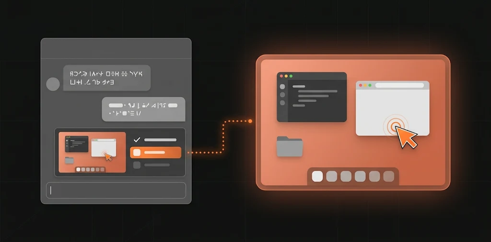
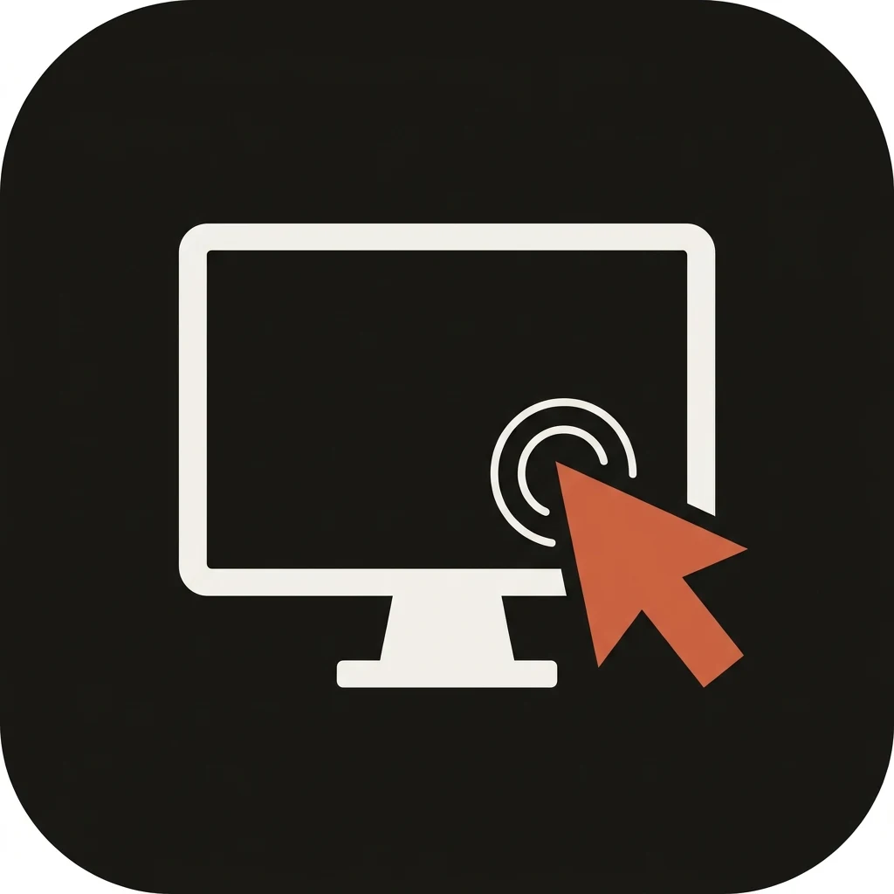
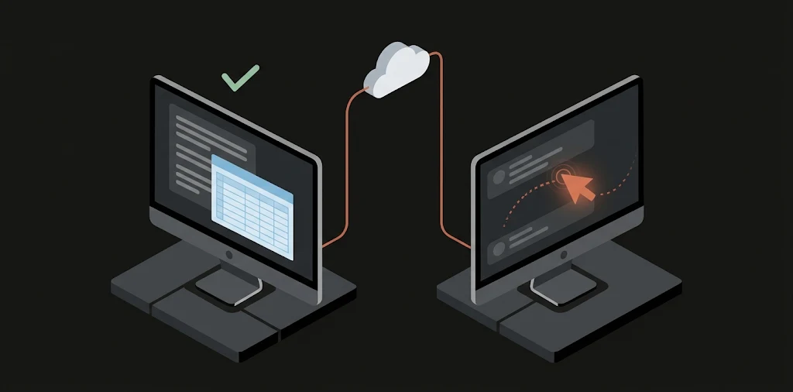
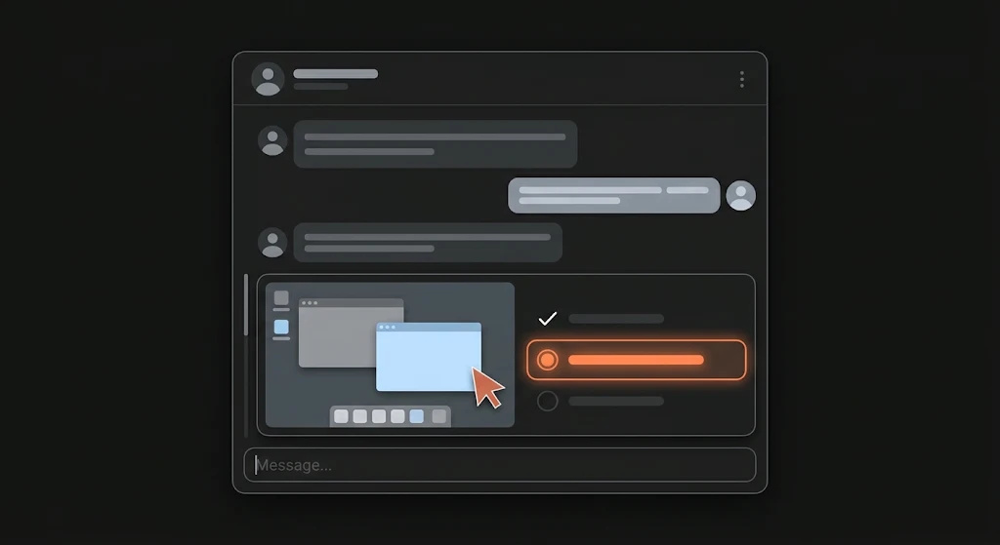
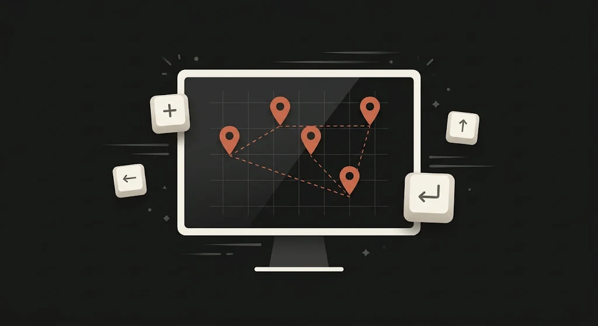
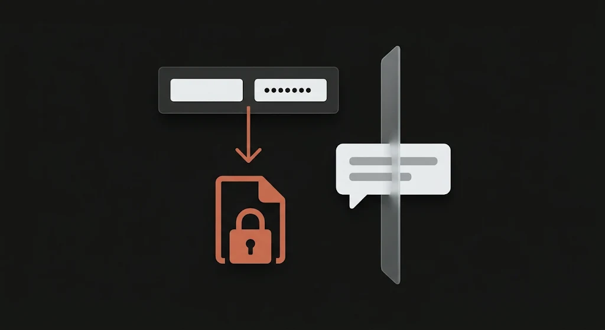

<p align="center">
  
</p>

<p align="center"></p>

<h1 align="center">Claude × RustDesk</h1>

<p align="center">
  <b>Deja que Claude trabaje en otro ordenador mientras tú sigues usando el tuyo.</b><br>
  Sin ocupar tu pantalla ni tu ratón. Tú solo miras cómo lo hace, encima de la barra de escribir.
</p>

<p align="center">
  <a href="README.md">English</a> ·
  <a href="#instalar">Instalar</a> ·
  <a href="#cómo-funciona">Cómo funciona</a> ·
  <a href="#límites">Límites</a>
</p>

---

## Por qué

Las herramientas para que una IA maneje un ordenador suelen quedarse con tu pantalla: mientras
el asistente hace clic, tú esperas. Este plugin le da a Claude su **propio** RustDesk sin
ventana, así que el equipo remoto se maneja en segundo plano y tu pantalla, tu ratón y tu
teclado siguen siendo tuyos.

| | |
|---|---|
|  | **Tu pantalla queda libre.** Claude se conecta con un RustDesk sin ventana. Sigue trabajando en otra cosa mientras la tarea se hace en el otro ordenador. |
|  | **Lo ves en directo.** Una franja encima de la barra de escribir muestra la pantalla remota, el puntero naranja de Claude y la lista de tareas: lo hecho, lo que hace ahora y lo que queda. |
|  | **Rápido, porque casi no mira.** Abre los programas por su nombre, usa atajos de teclado y apunta en un mapa de ese ordenador cada sitio donde pulsa. La próxima vez pulsa por nombre, sin captura. |
|  | **Tu contraseña no pasa por el chat.** Escribe `/rusdesk`, rellena ID y contraseña en el formulario y listo. Se guarda solo en tu ordenador y Claude no la lee. |

## Instalar

Requisitos: **Windows**, `python` en el PATH y [Claude Code](https://claude.com/claude-code)
(app de escritorio o terminal). El ordenador remoto solo necesita el RustDesk normal con una
contraseña permanente.

```
claude plugin install rustdesk-mcp --marketplace PantherCode57/Claude-Rustdesk_Plugin
```

En la app de escritorio: **+** junto a la barra de escribir → Plugins → Add marketplace →
`PantherCode57/Claude-Rustdesk_Plugin` → Add plugin.

## Usar

1. Escribe `/rusdesk`.
2. La primera vez: rellena el **ID** y la **contraseña** del otro ordenador y pulsa
   *Guardar y conectar*. Después, tus ordenadores guardados salen como botones; con un clic se
   conecta, sin volver a pedir la contraseña.
3. Pide lo que quieras con tus palabras:

> abre el Bloc de notas en el PC de la oficina y apunta los pedidos de hoy
>
> mira si terminó la copia de seguridad en el servidor
>
> imprime la factura que está abierta en Excel

## Cómo funciona

```
 tú ── chat ──▶ Claude ──▶ servidor MCP (Python) ──▶ RustDesk sin ventana ──▶ PC remoto
                   ▲                                        │
                   └──── visor encima de la barra de escribir ◀──┘
```

- **Servidor MCP `rustdesk`**: herramientas para conectar, abrir programas por nombre, pulsar
  atajos, escribir, hacer clic por nombre o por coordenadas y mirar la pantalla solo cuando hace falta.
- **Skill `/rusdesk`**: hace que Claude use estas herramientas en vez de ocupar tu pantalla.
- **Visor**: la franja encima de la barra de escribir (app de escritorio), o la dirección
  que te da Claude, en un navegador. Cada conversación tiene su propia conexión y su propio visor.
- **Puente** (`bin/rustdesk-claude.exe`): un cliente de RustDesk sin ventana, compilado del
  código oficial de RustDesk más el pequeño cambio que está en [`bridge/`](bridge/).

| Qué | Dónde |
|---|---|
| Ordenadores guardados y contraseñas | `C:\RustDeskClaude\peers.json` (no se sube, Claude no lo lee) |
| Mapa aprendido de cada ordenador | `C:\RustDeskClaude\maps\<nombre>.json` |
| Atajos y nombres de programas | [`maps/_atajos.json`](maps/_atajos.json) |

## Límites

- El puente es solo para Windows.
- En el ordenador remoto Windows tiene un único puntero: quien esté delante verá moverse su ratón.
- No se puede enviar Ctrl+Alt+Supr.
- El visor es para mirar, no para hacer clic. En la app del móvil no se dibuja.
- El campo de contraseña muestra lo que escribes (la app aún no tiene campos ocultos).

## Úsalo con cabeza

Conéctate solo a ordenadores tuyos o que tengas permiso para manejar. Claude tiene instrucciones
de dejar todo como estaba y de no borrar, enviar, comprar ni cambiar ajustes salvo que se lo
pidas exactamente.

## Licencia

AGPL-3.0, ver [LICENSE](LICENSE). El puente se compila a partir de
[RustDesk](https://github.com/rustdesk/rustdesk) (AGPL-3.0); los cambios están en [`bridge/`](bridge/).

Proyecto independiente, sin relación con Anthropic ni con RustDesk ni respaldado por ellos.
