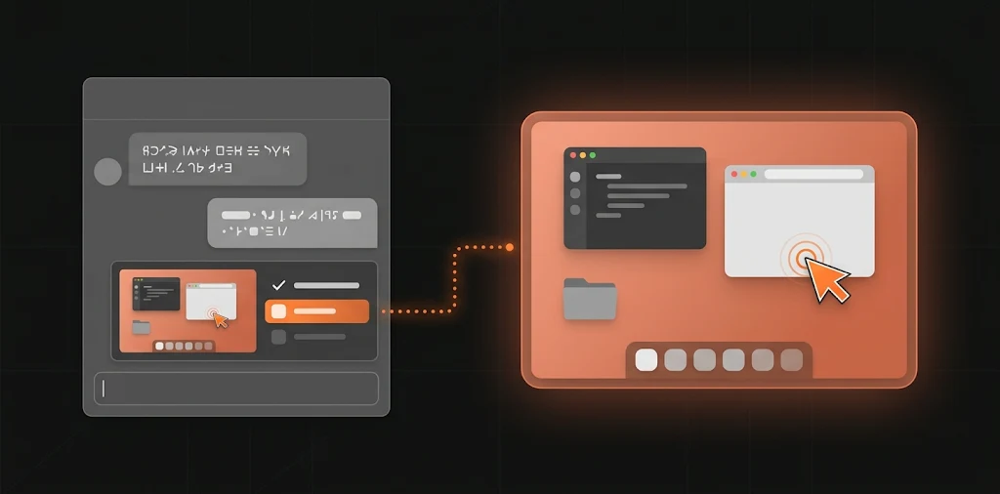
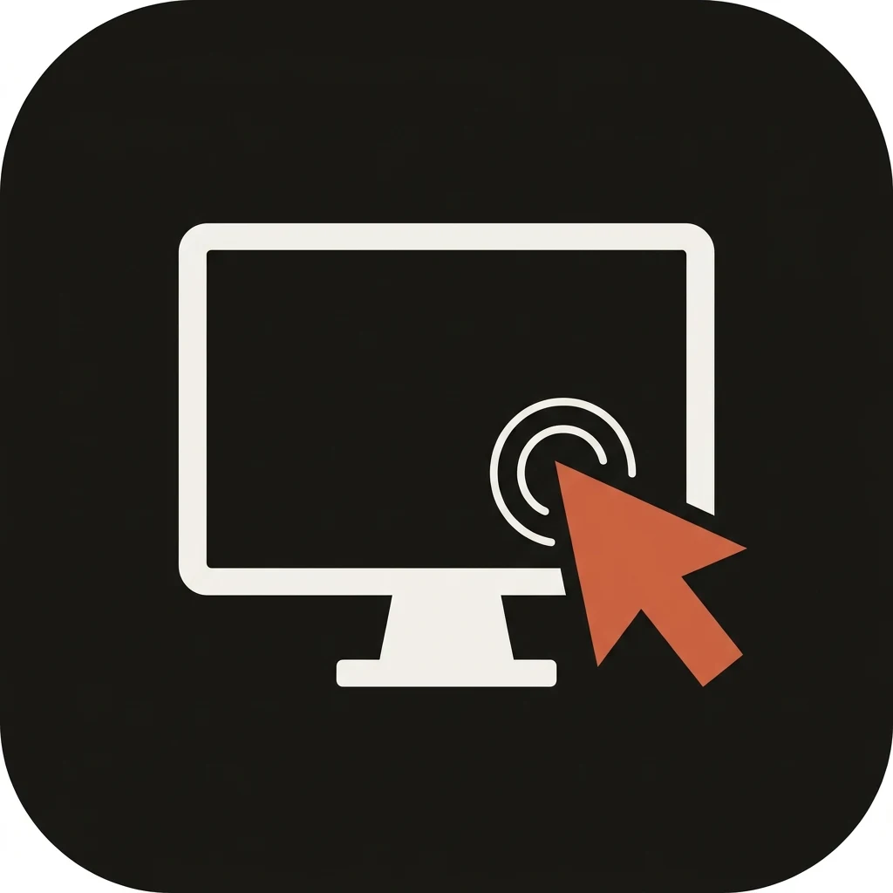
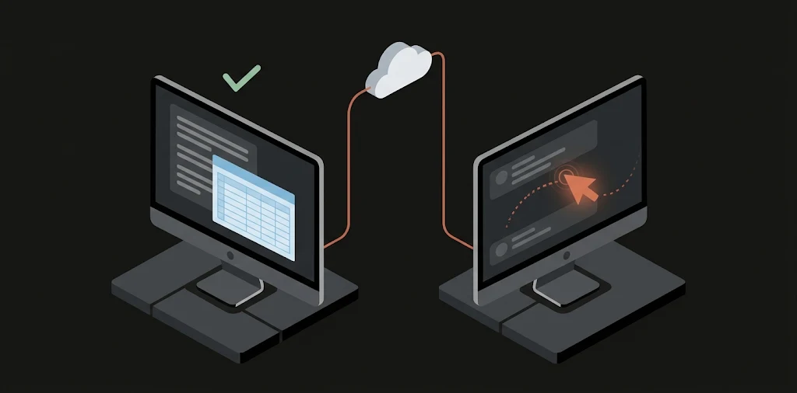
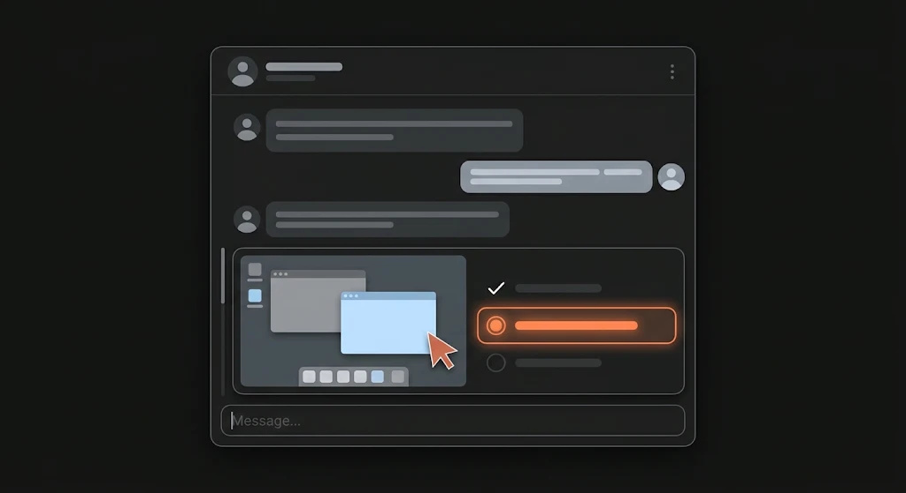
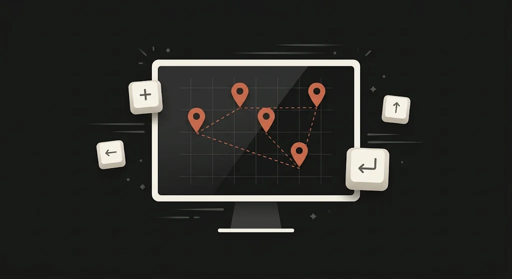
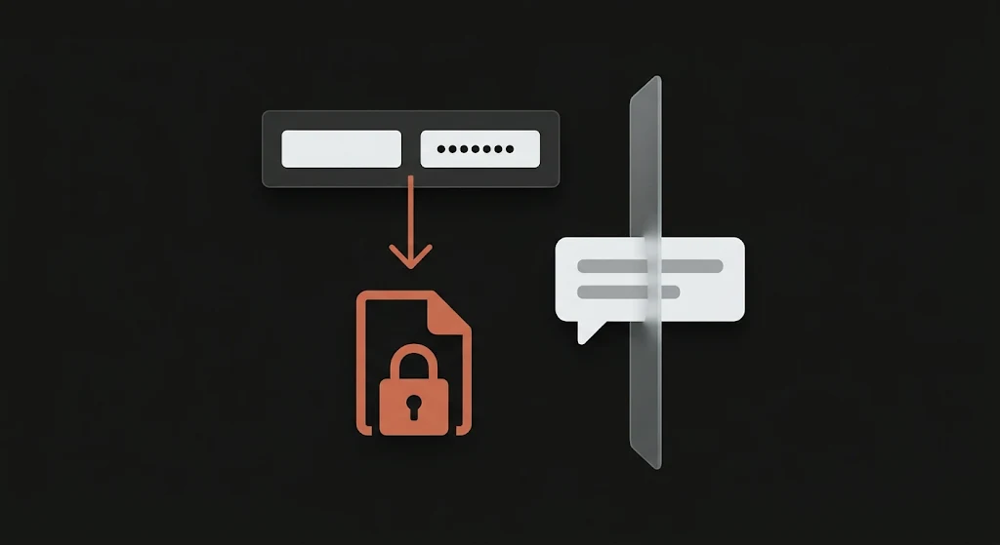

<p align="center">
  
</p>

<p align="center"></p>

<h1 align="center">Claude × RustDesk</h1>

<p align="center">
  <b>Let Claude work on another computer while you keep using yours.</b><br>
  No screen takeover. No mouse hijacking. You just watch it happen above the prompt.
</p>

<p align="center">
  <a href="README.es.md">Español</a> ·
  <a href="#install">Install</a> ·
  <a href="#how-it-works">How it works</a> ·
  <a href="#limits">Limits</a>
</p>

---

## Why

Remote-control tools for AI usually take over your own screen: while the assistant clicks, you
wait. This plugin gives Claude its **own** RustDesk client with no window, so the remote PC is
driven in the background and your screen, mouse and keyboard stay yours.

| | |
|---|---|
|  | **Your screen stays free.** Claude connects with a headless RustDesk client. Keep working, in another window or another app, while the task runs on the remote PC. |
|  | **Watch it live.** A band above the prompt shows the remote screen, Claude's own orange pointer and the task list: what is done, what it is doing now, what is left. |
|  | **Fast, because it rarely looks.** Programs are opened by name, actions go by keyboard shortcut, and every place Claude clicks is written to a map of that PC. Next time it clicks by name, with no screenshot. |
|  | **Your password never touches the chat.** Type `/rusdesk`, fill in ID and password in the form, done. It is saved on your machine only and Claude never reads it. |

## Install

Requirements: **Windows**, `python` on the PATH, and [Claude Code](https://claude.com/claude-code)
(desktop app or terminal). The remote computer only needs the normal RustDesk app with a
permanent password.

```
claude plugin install rustdesk-mcp --marketplace PantherCode57/Claude-Rustdesk_Plugin
```

In the desktop app: **+** next to the prompt → Plugins → Add marketplace →
`PantherCode57/Claude-Rustdesk_Plugin` → Add plugin.

## Use

1. Type `/rusdesk`.
2. First time: fill in the **ID** and the **password** of the other computer and press
   *Guardar y conectar*. After that, your saved computers appear as buttons; one click connects,
   no password needed again.
3. Ask for what you want, in your own words:

> open Notepad on the office PC and write down today's orders
>
> check whether the backup finished on the server
>
> print the invoice that is open in Excel

## How it works

```
 you ── chat ──▶ Claude ──▶ MCP server (Python) ──▶ headless RustDesk client ──▶ remote PC
                    ▲                                        │
                    └──────── live view above the prompt ◀───┘
```

- **MCP server `rustdesk`** – tools to connect, open programs by name, press shortcuts, type,
  click by name or by coordinates, and look at the screen only when needed.
- **Skill `/rusdesk`** – makes Claude use these tools instead of taking over your screen.
- **Live view** – the band above the prompt (desktop app), or the address Claude gives you, in a browser. Each conversation has its own remote session and its own view.
- **Bridge** (`bin/rustdesk-claude.exe`) – a RustDesk client with no window, built from the
  official RustDesk source plus the small patch in [`bridge/`](bridge/).

| What | Where |
|---|---|
| Saved computers and passwords | `C:\RustDeskClaude\peers.json` (never uploaded, never read by Claude) |
| Learned map of each computer | `C:\RustDeskClaude\maps\<name>.json` |
| Shortcuts and program names | [`maps/_atajos.json`](maps/_atajos.json) |

## Limits

- The bridge is Windows-only.
- Windows has a single pointer on the remote PC: whoever sits in front of it sees the mouse move.
- Ctrl+Alt+Del cannot be sent.
- The live view is for watching, not for clicking. It is not drawn in the mobile app.
- The password field shows what you type (the app has no hidden text field yet).

## Use it responsibly

Only connect to computers you own or are allowed to manage. Claude is told to leave things as it
found them and not to delete, send, buy or change settings unless you ask for exactly that.

## License

AGPL-3.0, see [LICENSE](LICENSE). The bridge is built from
[RustDesk](https://github.com/rustdesk/rustdesk) (AGPL-3.0); the changes are in [`bridge/`](bridge/).

This is an independent project. It is not affiliated with or endorsed by Anthropic or RustDesk.
